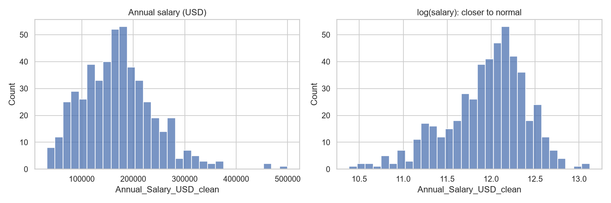
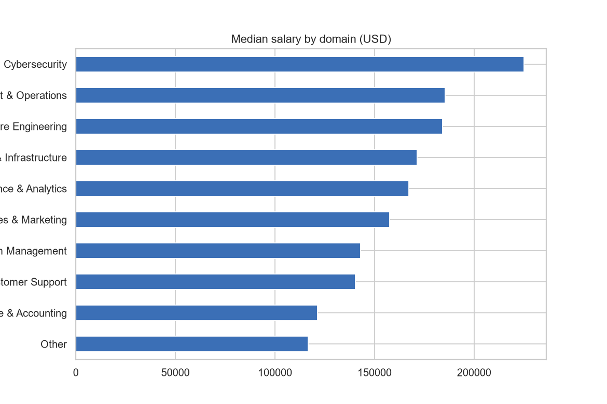
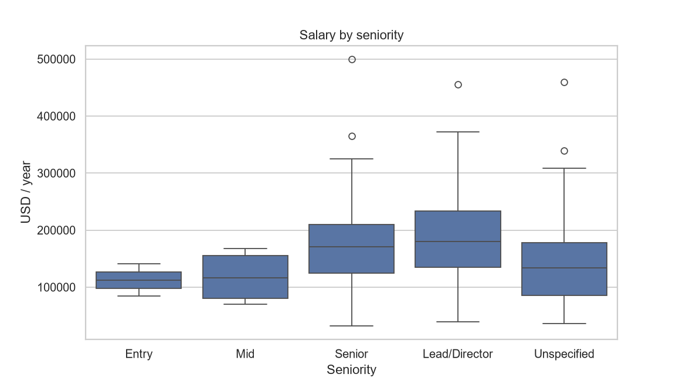
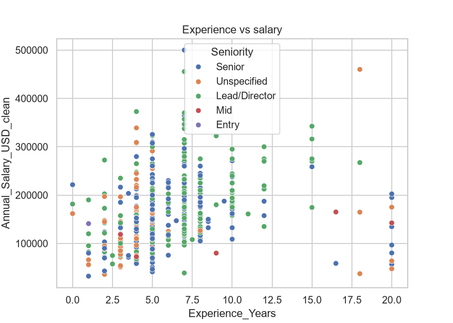
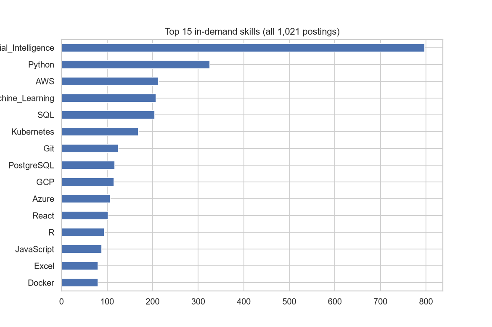
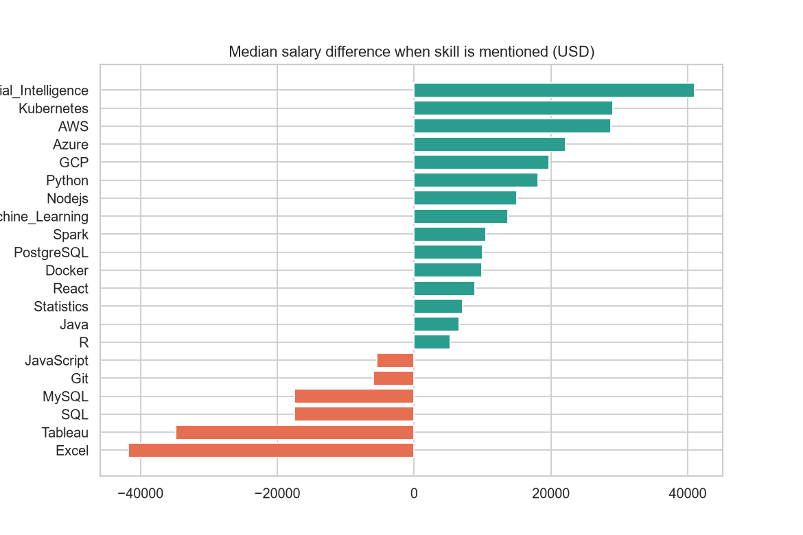
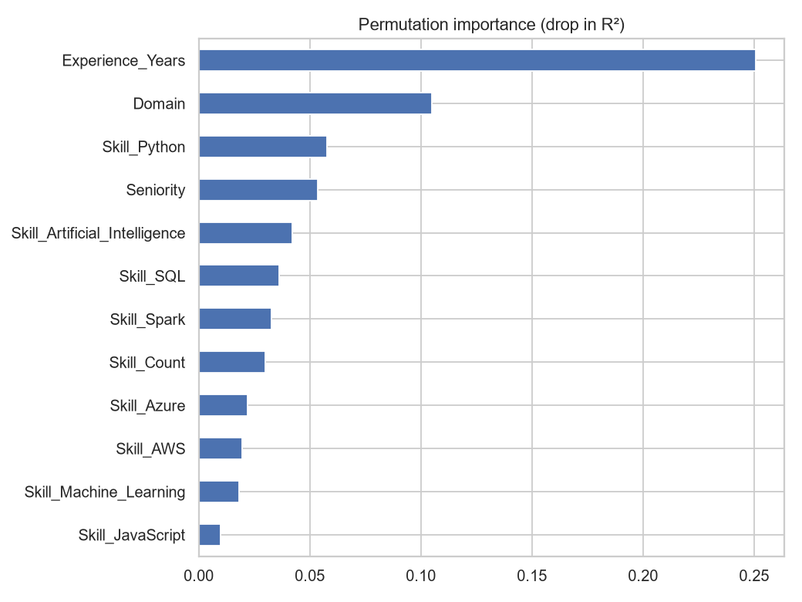
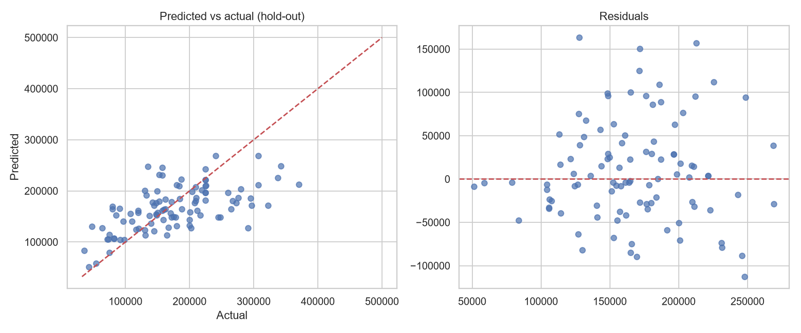
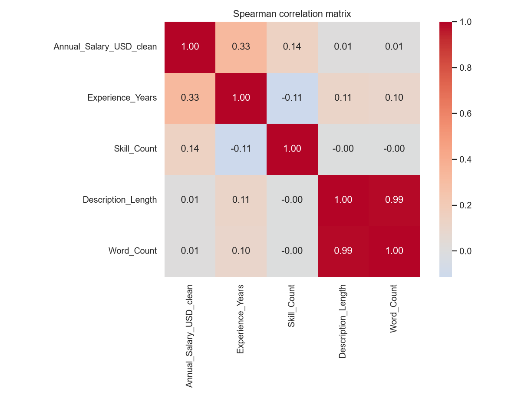
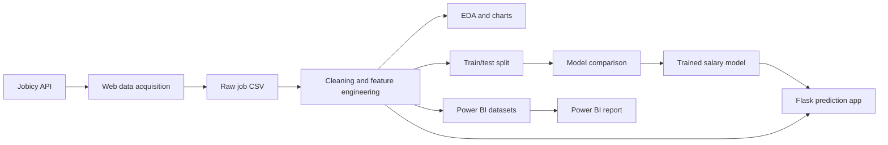

# 💼 Salary Predictor & Job Market Analytics

An end-to-end job-market analytics project that turns public remote-job data into practical salary insights and an interactive prediction experience.

<table>
  <thead>
    <tr>
      <th>Output</th>
      <th>Description</th>
    </tr>
  </thead>
  <tbody>
    <tr>
      <td>🧹 Clean dataset</td>
      <td>Standardized job, salary, experience, domain, and skill data</td>
    </tr>
    <tr>
      <td>📊 Exploratory analysis</td>
      <td>Charts and insights about the job market and salary patterns</td>
    </tr>
    <tr>
      <td>🤖 Salary model</td>
      <td>Trained and evaluated machine-learning models</td>
    </tr>
    <tr>
      <td>📈 Power BI report</td>
      <td>Interactive business-intelligence dashboards</td>
    </tr>
    <tr>
      <td>🌐 Flask application</td>
      <td>Browser-based salary prediction and JSON API</td>
    </tr>
  </tbody>
</table>


> **Project pipeline:** Web data acquisition → Data cleaning → Exploratory data analysis → Machine learning → Model training and testing → Power BI reporting → Flask deployment

<p align="center">
  <a href="#project-overview">Overview</a> •
  <a href="#pipeline">Pipeline</a> •
  <a href="#quick-start">Quick start</a> •
  <a href="#power-bi-report">Power BI</a> •
  <a href="#flask-application">Flask app</a>
</p>

---

## 🎯 Project overview

<table>
  <thead>
    <tr>
      <th>Item</th>
      <th>Details</th>
    </tr>
  </thead>
  <tbody>
    <tr>
      <td>🎯 Goal</td>
      <td>Analyze remote job-market data and estimate annual salary</td>
    </tr>
    <tr>
      <td>📌 Prediction inputs</td>
      <td>Seniority, domain, years of experience, and technical skills</td>
    </tr>
    <tr>
      <td>🌐 Data source</td>
      <td><a href="https://jobicy.com/api/v2/remote-jobs">Jobicy Remote Jobs API</a></td>
    </tr>
    <tr>
      <td>🔒 Runtime behavior</td>
      <td>The Flask app uses processed local data and the saved model; it does not make live API requests for predictions</td>
    </tr>
  </tbody>
</table>


## 🖼️ Analytics visual showcase

The following visuals are generated by the analysis notebook and are included in [`charts/`](./charts/). They demonstrate the project's business-analytics and data-science outputs directly in the repository.

<table>
  <thead>
    <tr>
      <th>Salary distribution</th>
      <th>Salary by domain</th>
    </tr>
  </thead>
  <tbody>
    <tr>
      <td></td>
      <td></td>
    </tr>
  </tbody>
</table>


<table>
  <thead>
    <tr>
      <th>Salary by seniority</th>
      <th>Salary by experience</th>
    </tr>
  </thead>
  <tbody>
    <tr>
      <td></td>
      <td></td>
    </tr>
  </tbody>
</table>


<table>
  <thead>
    <tr>
      <th>Top skills</th>
      <th>Skill premium analysis</th>
    </tr>
  </thead>
  <tbody>
    <tr>
      <td></td>
      <td></td>
    </tr>
  </tbody>
</table>


<table>
  <thead>
    <tr>
      <th>Feature importance</th>
      <th>Predicted versus actual salary</th>
    </tr>
  </thead>
  <tbody>
    <tr>
      <td></td>
      <td></td>
    </tr>
  </tbody>
</table>

<table>
  <thead>
    <tr>
      <th>Correlation heatmap</th>
      <th>Metrics and statistical analysis</th>
    </tr>
  </thead>
  <tbody>
    <tr>
      <td></td>
      <td>📌 Salary distribution, experience-salary correlation, skill-count correlation, median salary, and model-ready row counts are calculated in the notebook.</td>
    </tr>
  </tbody>
</table>


## 📈 Power BI report preview

The complete interactive report is available here:

<table>
  <thead>
    <tr>
      <th>Report</th>
      <th>Format</th>
      <th>Open with</th>
      <th>Contents</th>
    </tr>
  </thead>
  <tbody>
    <tr>
      <td><a href="./Final_Project.pbix"><code>Final_Project.pbix</code></a></td>
      <td>Power BI Desktop file</td>
      <td>Microsoft Power BI Desktop</td>
      <td>Job-market analysis, salary insights, model comparisons, feature importance, and skill-premium analysis</td>
    </tr>
  </tbody>
</table>


> **📌 Add a Power BI screenshot:** GitHub cannot render pages inside a `.pbix` file. To display a report preview here, export a report page from Power BI Desktop as a PNG or take a screenshot, save it as `charts/powerbi_report.png`, and add the following image below:
>
> ```markdown
> <p align="center">
>   
> </p>
> ```

## 🔄 Project pipeline



<table>
  <thead>
    <tr>
      <th>Step</th>
      <th>Component</th>
      <th>Main activities</th>
      <th>Main output</th>
    </tr>
  </thead>
  <tbody>
    <tr>
      <td>1️⃣</td>
      <td>🕸️ Web data acquisition</td>
      <td>Broad, keyword, and industry requests; deduplication by Jobicy ID; HTML-to-text cleaning</td>
      <td><code>raw_job_market_data.csv</code></td>
    </tr>
    <tr>
      <td>2️⃣</td>
      <td>🧹 Data cleaning and feature engineering</td>
      <td>Standardize job levels, domains, employment types, salary periods, and experience; normalize salary; remove duplicates; create skill features and <code>Skill_Count</code></td>
      <td><code>cleaned_job_market_data_v2.csv</code></td>
    </tr>
    <tr>
      <td>3️⃣</td>
      <td>📊 Visualization and EDA</td>
      <td>Explore salary distributions, domains, seniority, experience, skills, and model results</td>
      <td><a href="./charts/"><code>charts/</code></a></td>
    </tr>
    <tr>
      <td>4️⃣</td>
      <td>🤖 Machine learning</td>
      <td>Compare baseline, Ridge, Random Forest, and Gradient Boosting models; evaluate cross-validation and holdout performance</td>
      <td><a href="./model/salary_model.joblib"><code>model/salary_model.joblib</code></a>, <a href="./model/meta.json"><code>model/meta.json</code></a></td>
    </tr>
    <tr>
      <td>5️⃣</td>
      <td>📈 Power BI reporting</td>
      <td>Load cleaned data and model exports into interactive report pages</td>
      <td><a href="./Final_Project.pbix"><code>Final_Project.pbix</code></a></td>
    </tr>
    <tr>
      <td>6️⃣</td>
      <td>🌐 Flask application</td>
      <td>Load the model, validate inputs, return salary estimates, intervals, and skill suggestions</td>
      <td><a href="./app.py"><code>app.py</code></a>, <a href="./templates/index.html"><code>templates/index.html</code></a></td>
    </tr>
  </tbody>
</table>


The acquisition logic is implemented in [`01_web_scraping_job_market.py`](./01_web_scraping_job_market.py). The analysis and modeling workflow is implemented in [`task_2_3_4_improved.ipynb`](./task_2_3_4_improved.ipynb).

Current recorded results:

<table>
  <thead>
    <tr>
      <th>Model</th>
      <th>Cross-validation R²</th>
      <th>Cross-validation RMSE</th>
      <th>Cross-validation MAE</th>
    </tr>
  </thead>
  <tbody>
    <tr>
      <td>Baseline (median)</td>
      <td>-0.011</td>
      <td>70,802.93</td>
      <td>55,120.66</td>
    </tr>
    <tr>
      <td>Ridge</td>
      <td>0.095</td>
      <td>66,792.95</td>
      <td>50,890.86</td>
    </tr>
    <tr>
      <td>Random Forest</td>
      <td>0.198</td>
      <td>63,104.33</td>
      <td>47,528.26</td>
    </tr>
    <tr>
      <td><strong>Gradient Boosting</strong></td>
      <td><strong>0.251</strong></td>
      <td><strong>60,906.53</strong></td>
      <td><strong>46,141.99</strong></td>
    </tr>
  </tbody>
</table>


The recorded holdout results for Gradient Boosting are:

<table>
  <thead>
    <tr>
      <th>Metric</th>
      <th>Value</th>
    </tr>
  </thead>
  <tbody>
    <tr>
      <td>R²</td>
      <td>0.356</td>
    </tr>
    <tr>
      <td>RMSE</td>
      <td>58,584.65</td>
    </tr>
    <tr>
      <td>MAE</td>
      <td>44,970.60</td>
    </tr>
    <tr>
      <td>Model rows</td>
      <td>492</td>
    </tr>
  </tbody>
</table>


These metrics are estimates for this dataset and should not be interpreted as guaranteed salary accuracy.

### 5️⃣ Power BI reporting

<table>
  <thead>
    <tr>
      <th>Report asset</th>
      <th>Purpose</th>
    </tr>
  </thead>
  <tbody>
    <tr>
      <td><a href="./Final_Project.pbix"><code>Final_Project.pbix</code></a></td>
      <td>Main Power BI report</td>
    </tr>
    <tr>
      <td><code>cleaned_from_pbix.csv</code></td>
      <td>Cleaned table exported from the Power BI workflow</td>
    </tr>
    <tr>
      <td><code>powerbi_model_predictions.csv</code></td>
      <td>Model predictions for report visuals</td>
    </tr>
    <tr>
      <td><code>powerbi_model_comparison.csv</code></td>
      <td>Comparison of candidate models</td>
    </tr>
    <tr>
      <td><code>powerbi_feature_importance.csv</code></td>
      <td>Feature-importance output</td>
    </tr>
    <tr>
      <td><code>skill_premium.csv</code></td>
      <td>Skill-level salary premium analysis</td>
    </tr>
  </tbody>
</table>


<table>
  <thead>
    <tr>
      <th>Refresh action</th>
      <th>Instructions</th>
    </tr>
  </thead>
  <tbody>
    <tr>
      <td>🔄 Update report</td>
      <td>Open the PBIX file in Power BI Desktop and update its data-source paths to the repository CSV files</td>
    </tr>
  </tbody>
</table>


### 6️⃣ Flask application

<table>
  <thead>
    <tr>
      <th>Interface</th>
      <th>Method</th>
      <th>Function</th>
    </tr>
  </thead>
  <tbody>
    <tr>
      <td><code>/</code></td>
      <td><code>GET</code></td>
      <td>Serves the interactive browser interface</td>
    </tr>
    <tr>
      <td><code>/api/predict</code></td>
      <td><code>POST</code></td>
      <td>Returns a salary prediction, lower/upper interval, and skill suggestions</td>
    </tr>
    <tr>
      <td>Input validation</td>
      <td>—</td>
      <td>Validates level and domain and clamps experience to the supported range</td>
    </tr>
  </tbody>
</table>


## 🧰 Tools and technologies

<table>
  <thead>
    <tr>
      <th>Area</th>
      <th>Tools and technologies</th>
      <th>Purpose</th>
    </tr>
  </thead>
  <tbody>
    <tr>
      <td>Programming language</td>
      <td>🐍 Python</td>
      <td>Data processing, analysis, machine learning, and backend development</td>
    </tr>
    <tr>
      <td>Data acquisition</td>
      <td>🌐 Jobicy Remote Jobs API, <code>requests</code></td>
      <td>Collect public remote-job listings</td>
    </tr>
    <tr>
      <td>HTML processing</td>
      <td>🧽 BeautifulSoup, regular expressions</td>
      <td>Remove HTML and normalize job descriptions</td>
    </tr>
    <tr>
      <td>Data manipulation</td>
      <td>🐼 pandas, NumPy</td>
      <td>Cleaning, transformation, feature engineering, and numerical calculations</td>
    </tr>
    <tr>
      <td>Visualization</td>
      <td>📊 Matplotlib and notebook charts</td>
      <td>Explore salary, skills, domains, seniority, and model results</td>
    </tr>
    <tr>
      <td>Machine learning</td>
      <td>🤖 scikit-learn</td>
      <td>Train, compare, validate, and evaluate salary models</td>
    </tr>
    <tr>
      <td>Model persistence</td>
      <td>💾 joblib and JSON</td>
      <td>Save the trained model and prediction metadata</td>
    </tr>
    <tr>
      <td>Business intelligence</td>
      <td>📈 Microsoft Power BI</td>
      <td>Build interactive dashboards and report insights</td>
    </tr>
    <tr>
      <td>Web application</td>
      <td>⚡ Flask, HTML, CSS, JavaScript</td>
      <td>Serve the salary prediction interface and JSON API</td>
    </tr>
    <tr>
      <td>Development environment</td>
      <td>🧪 Jupyter Notebook, VS Code, virtual environment</td>
      <td>Reproducible development and experimentation</td>
    </tr>
    <tr>
      <td>Data exchange</td>
      <td>📄 CSV</td>
      <td>Store raw, cleaned, model, and Power BI data</td>
    </tr>
  </tbody>
</table>


## 📁 Repository structure

<table>
  <thead>
    <tr>
      <th>Path</th>
      <th>Type</th>
      <th>Role</th>
    </tr>
  </thead>
  <tbody>
    <tr>
      <td><a href="./01_web_scraping_job_market.py"><code>01_web_scraping_job_market.py</code></a></td>
      <td>Python script</td>
      <td>Collects and normalizes Jobicy listings</td>
    </tr>
    <tr>
      <td><a href="./task_2_3_4_improved.ipynb"><code>task_2_3_4_improved.ipynb</code></a></td>
      <td>Notebook</td>
      <td>Cleaning, EDA, feature engineering, training, testing, and exports</td>
    </tr>
    <tr>
      <td><a href="./app.py"><code>app.py</code></a></td>
      <td>Flask backend</td>
      <td>Serves the prediction UI and API</td>
    </tr>
    <tr>
      <td><a href="./templates/index.html"><code>templates/index.html</code></a></td>
      <td>HTML template</td>
      <td>Interactive salary predictor interface</td>
    </tr>
    <tr>
      <td><a href="./Final_Project.pbix"><code>Final_Project.pbix</code></a></td>
      <td>Power BI report</td>
      <td>Interactive dashboard and visual analysis</td>
    </tr>
    <tr>
      <td><code>cleaned_from_pbix.csv</code></td>
      <td>CSV dataset</td>
      <td>Cleaned Power BI data</td>
    </tr>
    <tr>
      <td><code>cleaned_job_market_data_v2.csv</code></td>
      <td>CSV dataset</td>
      <td>Model-ready data used by Flask</td>
    </tr>
    <tr>
      <td><code>powerbi_*.csv</code></td>
      <td>CSV exports</td>
      <td>Predictions, model comparison, and feature importance for Power BI</td>
    </tr>
    <tr>
      <td><code>skill_premium.csv</code></td>
      <td>CSV analysis</td>
      <td>Skill-level salary premium results</td>
    </tr>
    <tr>
      <td><a href="./charts/"><code>charts/</code></a></td>
      <td>Folder</td>
      <td>Generated exploratory and evaluation charts</td>
    </tr>
    <tr>
      <td><a href="./model/"><code>model/</code></a></td>
      <td>Folder</td>
      <td>Saved model and metadata</td>
    </tr>
  </tbody>
</table>


## 🚀 Quick start

### ✅ Requirements

<table>
  <thead>
    <tr>
      <th>Requirement</th>
      <th>Recommended use</th>
    </tr>
  </thead>
  <tbody>
    <tr>
      <td>Python 3.10+</td>
      <td>Run the scraper, notebook, and Flask app</td>
    </tr>
    <tr>
      <td>Power BI Desktop</td>
      <td>Open or refresh <code>Final_Project.pbix</code></td>
    </tr>
    <tr>
      <td>Jupyter, JupyterLab, or VS Code</td>
      <td>Run the analysis notebook</td>
    </tr>
  </tbody>
</table>


### 📦 Installation

<table>
  <thead>
    <tr>
      <th>Step</th>
      <th>Windows PowerShell command</th>
    </tr>
  </thead>
  <tbody>
    <tr>
      <td>1</td>
      <td><code>python -m venv .venv</code></td>
    </tr>
    <tr>
      <td>2</td>
      <td><code>.\.venv\Scripts\Activate.ps1</code></td>
    </tr>
    <tr>
      <td>3</td>
      <td><code>pip install -r requirements.txt</code></td>
    </tr>
  </tbody>
</table>


Windows Command Prompt alternative:

```bash
.venv\Scripts\activate
pip install -r requirements.txt
```

### 🕸️ Run the web data acquisition step

```bash
python 01_web_scraping_job_market.py
```

<table>
  <thead>
    <tr>
      <th>Result</th>
      <th>Details</th>
    </tr>
  </thead>
  <tbody>
    <tr>
      <td>Output</td>
      <td><code>raw_job_market_data.csv</code></td>
    </tr>
    <tr>
      <td>Source</td>
      <td>Jobicy Remote Jobs API</td>
    </tr>
    <tr>
      <td>Note</td>
      <td>Respect the source API's terms and rate limits</td>
    </tr>
  </tbody>
</table>


### 📓 Run the notebook

<table>
  <thead>
    <tr>
      <th>Action</th>
      <th>Details</th>
    </tr>
  </thead>
  <tbody>
    <tr>
      <td>Open</td>
      <td><code>task_2_3_4_improved.ipynb</code> in Jupyter Notebook, JupyterLab, or VS Code</td>
    </tr>
    <tr>
      <td>Run</td>
      <td>Execute the cells in order</td>
    </tr>
    <tr>
      <td>Creates</td>
      <td>Cleaned data, charts, model artifact, metadata, and Power BI export files</td>
    </tr>
  </tbody>
</table>


### 🌐 Run the Flask app

```bash
python app.py
```

<table>
  <thead>
    <tr>
      <th>Setting</th>
      <th>Default</th>
      <th>Description</th>
    </tr>
  </thead>
  <tbody>
    <tr>
      <td>URL</td>
      <td><http://127.0.0.1:5000></td>
      <td>Open this address after starting the server</td>
    </tr>
    <tr>
      <td><code>PORT</code></td>
      <td><code>5000</code></td>
      <td>Optional environment variable for changing the port</td>
    </tr>
  </tbody>
</table>


PowerShell example for a custom port:

```powershell
$env:PORT = "8000"
python app.py
```

## 🔌 API reference

<table>
  <thead>
    <tr>
      <th>Property</th>
      <th>Type</th>
      <th>Example</th>
      <th>Description</th>
    </tr>
  </thead>
  <tbody>
    <tr>
      <td><code>level</code></td>
      <td>String</td>
      <td><code>"Mid"</code></td>
      <td>Seniority level</td>
    </tr>
    <tr>
      <td><code>domain</code></td>
      <td>String</td>
      <td><code>"Data Science & Analytics"</code></td>
      <td>Job domain</td>
    </tr>
    <tr>
      <td><code>years</code></td>
      <td>Number</td>
      <td><code>4</code></td>
      <td>Years of experience</td>
    </tr>
    <tr>
      <td><code>skills</code></td>
      <td>Array of strings</td>
      <td><code>["Python", "SQL"]</code></td>
      <td>Selected skills</td>
    </tr>
  </tbody>
</table>


### Request

```bash
curl -X POST http://127.0.0.1:5000/api/predict ^
  -H "Content-Type: application/json" ^
  -d "{\"level\":\"Mid\",\"domain\":\"Data Science & Analytics\",\"years\":4,\"skills\":[\"Python\",\"SQL\",\"Power_BI\"]}"
```

Example request body:

```json
{
  "level": "Mid",
  "domain": "Data Science & Analytics",
  "years": 4,
  "skills": ["Python", "SQL", "Power_BI"]
}
```

### Response

```json
{
  "prediction": 85000,
  "low": 50000,
  "high": 135000,
  "suggestions": [
    {"skill": "Machine_Learning", "delta": 4200}
  ]
}
```

<table>
  <thead>
    <tr>
      <th>Response field</th>
      <th>Description</th>
    </tr>
  </thead>
  <tbody>
    <tr>
      <td><code>prediction</code></td>
      <td>Estimated salary</td>
    </tr>
    <tr>
      <td><code>low</code></td>
      <td>Estimated lower interval</td>
    </tr>
    <tr>
      <td><code>high</code></td>
      <td>Estimated upper interval</td>
    </tr>
    <tr>
      <td><code>suggestions</code></td>
      <td>Additional skills and their estimated salary deltas</td>
    </tr>
  </tbody>
</table>


Values in the example are illustrative; the actual response depends on the loaded model and dataset.

## 🔁 Reproducibility notes

<table>
  <thead>
    <tr>
      <th>Check</th>
      <th>Guidance</th>
    </tr>
  </thead>
  <tbody>
    <tr>
      <td>Notebook order</td>
      <td>Run the notebook before starting Flask if the model or processed data has changed</td>
    </tr>
    <tr>
      <td>Feature schema</td>
      <td>Keep the CSV columns consistent with the features in <code>model/meta.json</code></td>
    </tr>
    <tr>
      <td>Power BI paths</td>
      <td>Update local CSV paths after cloning to another machine</td>
    </tr>
    <tr>
      <td>Salary data</td>
      <td>Treat salary values and currencies as source-reported and potentially variable</td>
    </tr>
  </tbody>
</table>


## ⚠️ Limitations

<table>
  <thead>
    <tr>
      <th>Limitation</th>
      <th>Impact</th>
    </tr>
  </thead>
  <tbody>
    <tr>
      <td>📌 Sample coverage</td>
      <td>Job listings are a sample of the market, not a complete census</td>
    </tr>
    <tr>
      <td>💰 Salary quality</td>
      <td>Salary information may be missing, estimated, or reported in different currencies and periods</td>
    </tr>
    <tr>
      <td>📉 Model uncertainty</td>
      <td>Performance depends on the available postings and feature quality</td>
    </tr>
    <tr>
      <td>ℹ️ Intended use</td>
      <td>Predictions are informational estimates and should not replace compensation research or professional advice</td>
    </tr>
  </tbody>
</table>
